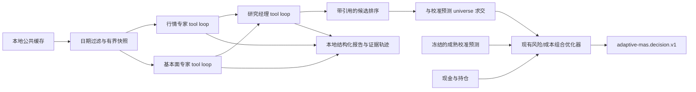

# GEPA 公共研究 Harness 架构

## 决策边界

Harness 允许语言模型读取点时公共证据、总结引用、向一个专家发起一次定向询问并给经理候选排序。它不能写收益值、权重或订单。最终排序会与本地 `loss_gated_fusion` 的成熟预测股票池求交；收益数值、风险预算、流动性、费用和组合权重都仍由数值预测与组合优化器确定。账户信息只进入本地优化器。

## 模块责任

| 模块 | 作用 | 关键约束 |
|---|---|---|
| `agents/public_experts.py` | 从本地公共数据缓存生成财务事实、公告/新闻和来源索引 | 不启动网络抓取；公告全文按需从已缓存文本读取 |
| `agents/public_prompt_context.py` | 按 `as_of` 过滤已发布且已可用记录，限制上下文大小并保留不透明证据引用 | 不暴露本地 `source_record_id`、路径、预测或账户字段 |
| `agents/harness.py` | OpenAI-compatible function-call 循环、行情/基本面/经理工具、schema 校验、上下文压缩、响应缓存与持久 ledger | 三个工具角色逐步交接；报告长度和条数参与软评分；类型、来源引用、同标的和时点仍硬校验；每案最多 10 轮，整个实验最多 160 次 provider 调用 |
| `agents/harness_prompts.py` | 六个可由 GEPA 修改的文本组件 | 工具 schema、固定评价权重和投资优化器不随候选演化 |
| `harness_evolution.py` | 官方 `gepa.optimize_anything`、离线分组、版本化评价、候选审计、版本与程序性经验存储 | 3 个探索、2 个选择、2 个冻结配对评价、1 个独立复用任务；最多一轮覆盖六个文本组件的反思变异 |
| `harness_runtime.py` | 稳定 Python 单日入口 | 预测预检仅运行一次，拒绝 seed 日期/期限不匹配，然后调用现有 `create_daily_decision` |
| `decision.py` | 校准预测与组合优化集成 | task cost 从单任务 `task_usage` 读取；不使用累计 ledger 账单作为一个决策的成本 |
| `scripts/run_harness_decision.py` | JSON 账户输入、缓存/seed 加载、版本/调用状态、`DailyDecision` JSON 输出 | 暖启动、配置错误、seed provenance 不匹配时不发请求 |
| `scripts/run_harness_evolution.py` | 离线 payload 审阅包；显式 `--execute-gepa` 后运行回顾性 GEPA | 先用共享 ledger 预留最多 156 次；未知请求结果未解决时停止 |
| `scripts/run_harness_paired_simulation.py` | 复用研究 JSON、同一次校准预测和相同初始账户，比较基准/候选筛选的短窗口模拟 | 无 provider 请求；只做一次下个交易日调仓并持有到期限结束 |
| `scripts/export_harness_version.py` | 导出活动版提示文本及完整性哈希 | 只导出六段提示，不含运行、账户、预测、评价或本地路径 |
| `scripts/harness_showcase.py` | 离线重评分、静态展示、版本比较和显式回滚 | 默认只读取发布的安全 JSON；`--rescore-local` 才读取本机完整轨迹；临时合成版本演示不改活动版本 |

## 一次日常决策

1. 校验 portfolio、`as_of` 交易日、预测期限、风险预算和调用上限。
2. 校验训练 seed 的截止日早于决策日，且 seed 期限等于预测期限。现有压缩 JSON 没有截止日/期限字段，所以这些来源值是调用方或仓库默认协议的显式声明，并写入 `versions`。
3. 只运行一次 `run_mvp_research`，确认指定日期存在成熟校准预测；暖启动立即返回 `warmup_no_action`。
4. 从本地缓存生成公开证据快照。市场与基本面专家调用各自的只读工具并提交结构化报告；研究经理读取压缩的专家交接、制定计划、按需提问并提交引用支持的排序。
5. 在共享 ledger 和响应缓存上运行，最多执行 10 次新 provider 请求。重复请求可复用精确响应；实际增量 API 费和逻辑比较成本分开。
6. 使用前置计算的校准预测进入既有组合优化器，返回正常 `DailyDecision` JSON。账户字段不会进入模型出站 prompt。

可将 GEPA 同轮 `reuse_demo_research.json` 交给单日 API：它必须匹配日期、活动版本和程序性经验哈希。这个路径可为本地账户决策演示复用研究结果，不产生新的 provider 请求。

## GEPA 演化和候选接纳

- 日期由公开本地缓存确定并去重；分组为 exploration 3、selection 2、frozen evaluation 2、单独 reuse 1。所有分组均为回顾性，不是盲测。
- GEPA 的 evaluator 输入只有公开决策日。公开研究结果通过固定事实/引用评价器评分：事实准确、必答事实覆盖、引用精度、报告期和点时准确、工具效率、模型成本。
- evaluator v2 精确处理市场来源的 `metric`/`value` 字段契约；必答事实按实际条数计算，零条记为 N/A 并从综合分权重中剔除后重新归一。简洁度、输出完整度和工具效率均为软评分；来源真实性、引用对应、类型、报告期和点时仍由硬边界保护。
- 探索评价由 `(candidate, as_of)` 缓存去重，至多 6 个唯一任务；`max_metric_calls=8` 是 GEPA evaluator 回调上限，不是唯一 case 数。
- 每案最多 10 轮；一次 GEPA 变异反思全部六个文本组件，各发一个请求。最坏上界是 15 个研究任务 × 10 轮 + 6 次反思 = 156 次 provider 请求。六个候选组件均保留在版本中。
- 候选需先严格提高探索集分数，再在两例独立选择集上严格提高综合分，并且事实、引用、报告期和点时指标不低于活动版本，方可写入活动版本。否则保留现有版本。
- 两个冻结日期对活动旧版和接纳新版做配对评价，不能用于候选选择。独立 reuse 日期验证新任务重新加载活动版本及持久化程序性经验。
- 每个新 agent trace 记录角色、工具轮次和发生过的上下文压缩统计，不记录压缩前后的正文。已有旧 trace 缺少该字段时明确标注“未记录”。
当前实测结果和可提交安全产物见 [安全运行报告](reports/harness_20261023/RUN_REPORT.md)。原始 outgoing review、反思 payload、冻结逐轮记录、调用账单和响应缓存仅保留在本机。未来 run 的空白模板见 HARNESS_RUN_REPORT_TEMPLATE.md。

## v2 评估与离线展示

已发布的静态页 [GEPA 多智能体研究工作台](reports/harness_20261023/showcase.html) 和 [v2 重评分 JSON](reports/harness_20261023/evaluator_v2_rescore.json) 不包含完整报告轨迹、原始提示或来源正文。它们对保存的 2026-08-31 报告分别显示历史评估器与 evaluator v2：事实准确率由 25% 修正为 100%，因为旧评估器将三个行情事实查入了错误字段；这是同一输出的评估口径修正，不是新模型表现。必答事实覆盖仍为 1/2。历史 `RUN_REPORT.md` 的结果与分数未改写。其余仅有汇总分数的历史分区标为轨迹不完整、不可比较。

在完整本机数据可用时，`python scripts/harness_showcase.py render --rescore-local` 可重新计算该单个完整轨迹；普通 `render` 只读取随仓库发布的安全 JSON。版本差异可用 `python scripts/harness_showcase.py compare --version-dir <store> --left <version-a> --right <version-b>` 查看；显式回滚使用 `python scripts/harness_showcase.py rollback --version-dir <store> --version-id <existing-version> --reason <reason>`。只在用户明确指定 store 和版本后才会更改活动指针。展示页的采用/记忆读回/回滚闭环由临时目录中的合成 fixture 演示，不代表真实候选被采纳、模型质量提升或投资收益。

## 成本、隐私和故障

日常与演化入口共享 `experiments/gepa_harness/calls.jsonl` 与 `response_cache/`，provider call 硬顶为 160。每次请求限制 24,000 UTF-8 输入字节和 1,200 输出 token。规划单价使用 ¥12/百万输入 token、¥36/百万输出 token，不假设缓存折扣；156 次单轮上界为 ¥51.6672，160 次共享硬顶为 ¥52.992；审阅包记录实际适用的请求限制与成本公式。

没有可确认响应的已启动调用会保持 unresolved。重启时只在请求 SHA 完全相同的缓存命中后恢复已知结果；否则停止并要求人工确认，不重放以免重复收费。请求日志不写鉴权密钥。不要把未授权数据、账号或私有信号放入公共缓存或提示。

## 回顾性缓存的边界

正常前向 API 默认要求真实抓取时间也早于决策时点。显式 `--retrospective-public-cache` 仅允许已缓存财务事实、报表和公告标题按公开披露/可用日期作为历史代理，保留真实 `fetched_at` 并标记 vintage 未验证；公告正文、新闻、宏观和关注数据不放宽。此数据模式始终报告 `strict_historical_pit_verified=false`。它用于有明确标记的离线历史评估，不代表当时系统已捕获或供应商历史版本。每案的唯一来源数表示本地缓存证据目录覆盖，模型通过有界分页工具和按需读取使用其中的子集，不会一次收到全部来源。

## 已完成运行及产物路径

20261023104652 的 GEPA 运行拒绝了唯一去重提案，活动版本保持 seed；没有投资改善证据。冻结配对两臂也都使用 seed，后续请求序列不同，不能据此归因候选效果。可提交汇总见 [安全运行报告](reports/harness_20261023/RUN_REPORT.md)。

提交包只包含汇总结果、active seed 六组件提示、真实 rejected-proposal diff 和必要候选审计，均位于 reports/harness_20261023。完整的日常复用 JSON 和模拟 JSON 未纳入提交包；原始 checkpoint、candidate pool、反思 review 与运行日志仅保存在本机 data/processed/harness_versions/runs/20261023104652/，调用账本和缓存仅保存在本机 experiments/gepa_harness/calls.jsonl 与 experiments/gepa_harness/response_cache/。

共享 ledger 累计 111 次已完成 provider 请求，增量费用估算 ¥3.980232；42 次精确响应复用的逻辑成本估算 ¥1.139268。两次连接前失败均未发送且计费为零。所有成本使用预算单价推算，未与服务账单核对。数据仅为回顾性公共证据代理，strict_historical_pit_verified 为 false。
